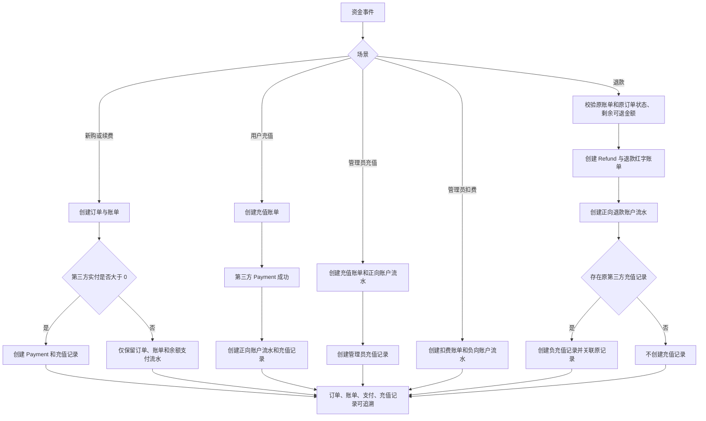

# Financial Document Generation Rules

## 1. Scope and Entity Mapping

These rules cover six types of fund events: new purchase, renewal, user recharge, refund, admin deduction, and admin recharge.

Term mapping within the project is as follows:

| Business term       | Authoritative entity                          | Role                                                                                                                                               |
| ------------------- | --------------------------------------------- | -------------------------------------------------------------------------------------------------------------------------------------------------- |
| Order               | `orders` / `Order`                            | Records the service transaction and fulfillment details; may be omitted for pure account recharge and admin balance adjustment.                    |
| Invoice             | `invoices` / `Invoice`                        | Primary financial document; records receivables, received amounts, recharges, deductions, and refund red-letter invoices.                          |
| Account transaction | `account_transactions` / `AccountTransaction` | Records changes to the cash account balance and is the transaction voucher for invoice payment and balance crediting.                              |
| Third-party payment | `payments` / `Payment`                        | Records only real external fund inflows such as Alipay and WeChat Pay; balance, free, and manually provisioned orders must not create a `Payment`. |
| Recharge record     | `recharge_records` / `RechargeRecord`         | Records the source of a balance credit, or the offset of a refund against the original third-party credit source.                                  |
| Refund              | `refunds` / `Refund`                          | Records one refund operation; also generates a refund red-letter invoice linked to the original invoice.                                           |

`Invoice` is the invoice entity in the current architecture; a parallel `bills` table must not be created. `AccountTransaction` is the balance-change transaction record that completes the auditable evidence for invoice payment, recharge, deduction, and refund.

## 2. Design Decisions

- Every write is coordinated by `PaymentService` inside a database transaction and business lock; `FinanceDocumentService` is only responsible for document linkage, amount validation, and idempotent creation.
- All new amount columns use `decimal(12,2)`; the currency of all documents and account transactions is always written as `CNY`.
- Recharge records achieve idempotency through a unique constraint on `payment_id` or `account_transaction_id`; repeated triggers from payment callbacks and status polling never create duplicate records.
- Refunds use a separate `refunds` row and an `invoices.type=refund` red-letter invoice instead of physically deleting the original order, original invoice, or original payment record.
- `Payment` still records third-party funds only. A refund of a pure balance payment may run without a `Payment`, but it must still generate a refund record, a red-letter invoice, and an account transaction.

## 3. Database Design

Migration files:

- `backend/database/migrations/2026_07_18_190000_create_finance_document_records.php`
- `backend/database/migrations/2026_07_18_191000_add_currency_to_finance_documents.php`

### 3.1 New Columns on Existing Tables

| Table                  | Column              | Constraint/Default                                           | Purpose                                                      |
| ---------------------- | ------------------- | ------------------------------------------------------------ | ------------------------------------------------------------ |
| `invoices`             | `origin_invoice_id` | Nullable, foreign key → `invoices.id`, set to null on delete | Links the refund red-letter invoice to the original invoice. |
| `orders`               | `currency`          | `char(3)`, default `CNY`                                     | Order currency.                                              |
| `invoices`             | `currency`          | `char(3)`, default `CNY`                                     | Invoice currency.                                            |
| `payments`             | `currency`          | `char(3)`, default `CNY`                                     | Third-party payment currency.                                |
| `account_transactions` | `currency`          | `char(3)`, default `CNY`                                     | Account transaction currency.                                |

The default backfills historical rows with `CNY`; new writes must always state the currency semantics.

### 3.2 `refunds`

| Field                                                                                | Description                                                                         |
| ------------------------------------------------------------------------------------ | ----------------------------------------------------------------------------------- |
| `refund_no`                                                                          | Unique refund number.                                                               |
| `user_id`, `invoice_id`                                                              | The user the refund belongs to and the original invoice.                            |
| `refund_invoice_id`                                                                  | Links to the refund red-letter invoice created for this operation.                  |
| `payment_id`                                                                         | The original third-party payment; nullable, empty for pure balance payment refunds. |
| `amount`, `currency`, `refund_method`, `status`                                      | Refund amount, currency, channel, and status.                                       |
| `reason`, `operator_type`, `operator_id`, `operator_name`, `refunded_at`, `trace_id` | Refund reason, admin audit information, timestamp, and trace ID.                    |

### 3.3 `recharge_records`

| Field                                           | Description                                                                       |
| ----------------------------------------------- | --------------------------------------------------------------------------------- |
| `record_no`                                     | Unique recharge record number.                                                    |
| `user_id`, `order_id`, `invoice_id`             | User, order, and invoice linkage; `order_id` may be empty when there is no order. |
| `payment_id`                                    | Third-party payment link; unique and nullable.                                    |
| `account_transaction_id`                        | Account transaction link; unique and nullable.                                    |
| `refund_id`, `origin_recharge_record_id`        | The refund record and the original recharge record being offset.                  |
| `scene`                                         | `new_purchase`, `renewal`, `user_recharge`, `admin_recharge`, `refund`.           |
| `direction`, `amount`, `currency`, `entry_type` | Income/offset direction, two-decimal amount, `CNY`, and concrete source type.     |
| `remark`, `operator_*`, `trace_id`              | Business remark, admin audit, and trace ID.                                       |

Key indexes: `invoice_id`, `order_id`, `origin_recharge_record_id`, `user_id + created_at`; refund offsets remain fully traceable through the self-referencing records.

## 4. Rules for the Six Scenarios

| Scenario        | Required documents                                      | Recharge record                                                                       | Amount and linkage rules                                                                                                                                          |
| --------------- | ------------------------------------------------------- | ------------------------------------------------------------------------------------- | ----------------------------------------------------------------------------------------------------------------------------------------------------------------- |
| New purchase    | `Order` + `Invoice`                                     | Created only when the third-party paid amount is greater than 0                       | The recharge record links the order, invoice, and payment; mixed payments record only the third-party portion.                                                    |
| Renewal         | `Order` + `Invoice`, `type=renew`                       | Same as new purchase                                                                  | On payment completion, validate `账单金额 = 余额支付额 + 第三方支付额`.                                                                                           |
| User recharge   | `Invoice(type=recharge)` + `AccountTransaction`         | Must be created                                                                       | The recharge record binds the invoice, third-party payment, and balance crediting transaction; pure account recharge currently creates no order.                  |
| Refund          | `Refund` + `Invoice(type=refund)` + account transaction | Created as a negative record only when an original third-party recharge record exists | The red-letter invoice points to the original invoice via `origin_invoice_id`; the negative record points to the original source via `origin_recharge_record_id`. |
| Admin deduction | `Invoice(type=deduction)` + `AccountTransaction`        | Creation forbidden                                                                    | Records the operator, time, reason, user, and trace ID.                                                                                                           |
| Admin recharge  | `Invoice(type=recharge)` + `AccountTransaction`         | Must be created                                                                       | `remark` is fixed to `管理员手工充值`, and the operator, time, and reason are recorded.                                                                           |

Amount constraints:

1. New purchase and renewal: the order amount, the invoice amount, and the sum of the balance payment amount plus the third-party payment amount must be equal; when a recharge record exists, its amount equals the third-party paid amount.
2. User recharge and admin recharge: the recharge record amount must match the recharge invoice amount and the positive account transaction amount.
3. Admin deduction: the account transaction amount is negative, and no recharge record may be created.
4. Refund: the refund amount must not exceed the remaining refundable amount of the original order; the absolute value of the negative recharge record amount must not exceed the remaining offsettable amount of the original recharge record. A mixed-payment refund may include the balance portion, and that portion generates no negative recharge record.
5. All amounts are stored as `decimal(12,2)` in the database, and the service uniformly formats them to two decimal places when writing.

## 5. Business Flow Diagram



## 6. External API Contract

The system reuses the existing v2 admin routes and adds no parallel endpoints. A successful response uniformly keeps `code = 0`.

### 6.1 Admin Balance Adjustment

`POST /api/v2/admin/users/{user}/recharges`

- Permission: `user.recharge`
- Request body:

```json
{
  "amount": 100.0,
  "remark": "活动补偿充值"
}
```

- `amount > 0` is an admin recharge, `amount < 0` is an admin deduction; it must not be 0.
- `remark` is required, maximum 200 characters.
- `detail.documents` in the response carries the newly added linkage information:

```json
{
  "code": 0,
  "data": {
    "id": 42,
    "status": "completed",
    "message": "余额增加成功",
    "detail": {
      "type": "balance_adjustment",
      "user": { "id": 42 },
      "adjustment": { "amount": "100.00", "direction": "increase" },
      "documents": {
        "invoice_id": 501,
        "account_transaction_id": 801,
        "recharge_record_id": 901
      }
    }
  }
}
```

For a deduction, `recharge_record_id` is `null`.

### 6.2 Admin Refund to Account Balance

`POST /api/v2/admin/users/{user}/invoices/{invoice}/refunds`

- Permission: `invoice.manage`
- Request body:

```json
{
  "refund_method": "balance",
  "amount": 100.0,
  "remark": "服务无法交付，退款到余额",
  "scope": ["order", "payment"]
}
```

- `refund_method` accepts only `balance` or `original`; `balance` follows the refund loop defined in these rules.
- The original invoice must be paid or partially refunded, and the linked order must be paid or completed.
- `amount` may be omitted (meaning the remaining refundable amount); when provided, it must not exceed the remaining refundable amount.
- `detail.documents` in the response allows immediate lookup of the documents generated by this operation:

```json
{
  "refund_id": 1001,
  "refund_invoice_id": 1002,
  "recharge_record_id": 1003
}
```

For a pure balance payment refund with no original third-party recharge record, `recharge_record_id` is `null`.

## 7. Audit and Security Boundaries

- Admin endpoints use Sanctum admin authentication and the existing permission middleware; the controller only passes the validated request to the service layer.
- Admin recharge, deduction, and refund all record the operator, operation time, reason/remark, user, invoice, and `trace_id`; the refund account transaction also records the operator and trace ID.
- Refunds, recharge callbacks, and balance adjustments are all handled inside transactions; payment callbacks and recharge records guarantee idempotency through unique keys.
- Third-party callback payloads, keys, tokens, or sensitive account information are not returned; the API returns only traceable internal document IDs.
