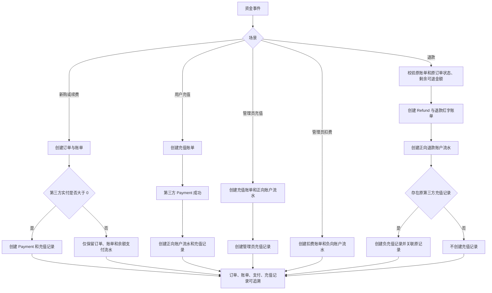

<!-- 本檔案由 docs-i18n.mjs trad zh-hk 從 docs/develop/financial-documents.md 產生，請勿手動編輯。 -->
# 財務單據生成規則

## 1. 範圍與實體映射

本規則覆蓋新購、續費、用戶充值、退款、管理員扣費、管理員充值六類資金事件。

項目內的術語映射如下：

| 業務術語   | 權威實體                                      | 作用                                                                           |
| ---------- | --------------------------------------------- | ------------------------------------------------------------------------------ |
| 訂單       | `orders` / `Order`                            | 記錄服務交易和履約明細；純賬戶充值、管理員餘額調整可省略。                     |
| 賬單       | `invoices` / `Invoice`                        | 財務主單據，記錄應收、已收、充值、扣費和退款紅字賬單。                         |
| 賬戶流水   | `account_transactions` / `AccountTransaction` | 記錄現金賬戶餘額變化，是賬單支付和餘額入賬的流水憑證。                         |
| 第三方支付 | `payments` / `Payment`                        | 僅記錄支付寶、微信等真實外部資金流入；餘額、免費、人工開通不得創建 `Payment`。 |
| 充值記錄   | `recharge_records` / `RechargeRecord`         | 記錄餘額入賬來源或退款對原第三方入賬來源的衝抵。                               |
| 退款單     | `refunds` / `Refund`                          | 記錄一次退款操作；同時生成關聯原賬單的退款紅字賬單。                           |

`Invoice` 是當前架構中的賬單主體，不能另建平行的 `bills` 表。`AccountTransaction` 是餘額變動流水，補足賬單支付、充值、扣費和退款的可審計證據。

## 2. 設計決策

- 每個寫入由 `PaymentService` 在數據庫事務和業務鎖內協調，`FinanceDocumentService` 只負責單據關聯、金額校驗和冪等創建。
- 所有新增金額列使用 `decimal(12,2)`，所有單據和賬戶流水幣種固定寫入 `CNY`。
- 充值記錄以 `payment_id` 或 `account_transaction_id` 唯一約束實現冪等；支付回調、狀態輪詢重複觸發時不會重複建檔。
- 退款使用獨立 `refunds` 行和 `invoices.type=refund` 紅字賬單，而不物理刪除原訂單、原賬單或原支付記錄。
- `Payment` 仍只記錄第三方資金。純餘額支付退款允許沒有 `Payment`，但仍必須生成退款單、紅字賬單和賬戶流水。

## 3. 數據庫設計

遷移文件：

- `backend/database/migrations/2026_07_18_190000_create_finance_document_records.php`
- `backend/database/migrations/2026_07_18_191000_add_currency_to_finance_documents.php`

### 3.1 既有表的新增字段

| 表                     | 字段                | 約束/默認值                          | 用途                     |
| ---------------------- | ------------------- | ------------------------------------ | ------------------------ |
| `invoices`             | `origin_invoice_id` | 可空，外鍵 → `invoices.id`，刪除置空 | 退款紅字賬單關聯原賬單。 |
| `orders`               | `currency`          | `char(3)`，默認 `CNY`                | 訂單幣種。               |
| `invoices`             | `currency`          | `char(3)`，默認 `CNY`                | 賬單幣種。               |
| `payments`             | `currency`          | `char(3)`，默認 `CNY`                | 第三方支付幣種。         |
| `account_transactions` | `currency`          | `char(3)`，默認 `CNY`                | 賬戶流水幣種。           |

默認值會將歷史行補為 `CNY`，新寫入不允許省略幣種語義。

### 3.2 `refunds`

| 字段                                                                                 | 説明                                     |
| ------------------------------------------------------------------------------------ | ---------------------------------------- |
| `refund_no`                                                                          | 唯一退款單號。                           |
| `user_id`、`invoice_id`                                                              | 退款所屬用戶與原賬單。                   |
| `refund_invoice_id`                                                                  | 關聯本次創建的退款紅字賬單。             |
| `payment_id`                                                                         | 原第三方支付，可空；純餘額支付退款為空。 |
| `amount`、`currency`、`refund_method`、`status`                                      | 退款金額、幣種、渠道和狀態。             |
| `reason`、`operator_type`、`operator_id`、`operator_name`、`refunded_at`、`trace_id` | 退款原因、管理員審計信息、時間和鏈路號。 |

### 3.3 `recharge_records`

| 字段                                            | 説明                                                                     |
| ----------------------------------------------- | ------------------------------------------------------------------------ |
| `record_no`                                     | 唯一充值記錄號。                                                         |
| `user_id`、`order_id`、`invoice_id`             | 用戶、訂單和賬單關聯；無訂單場景允許 `order_id` 為空。                   |
| `payment_id`                                    | 第三方支付關聯，唯一且可空。                                             |
| `account_transaction_id`                        | 賬戶流水關聯，唯一且可空。                                               |
| `refund_id`、`origin_recharge_record_id`        | 退款單及被衝抵的原充值記錄。                                             |
| `scene`                                         | `new_purchase`、`renewal`、`user_recharge`、`admin_recharge`、`refund`。 |
| `direction`、`amount`、`currency`、`entry_type` | 收入/衝抵方向、兩位小數金額、`CNY`、具體來源類型。                       |
| `remark`、`operator_*`、`trace_id`              | 業務備註、管理員審計和鏈路追蹤。                                         |

關鍵索引：`invoice_id`、`order_id`、`origin_recharge_record_id`、`user_id + created_at`；退款衝抵通過自關聯記錄可完整追溯。

## 4. 六類場景規則

| 場景       | 必建單據                                         | 充值記錄                           | 金額與關聯規則                                                                               |
| ---------- | ------------------------------------------------ | ---------------------------------- | -------------------------------------------------------------------------------------------- |
| 新購       | `Order` + `Invoice`                              | 僅第三方實付金額大於 0 時創建      | 充值記錄關聯訂單、賬單、支付；混合支付僅記錄第三方部分。                                     |
| 續費       | `Order` + `Invoice`，`type=renew`                | 同新購                             | 支付完成時校驗 `账单金额 = 余额支付额 + 第三方支付额`。                                      |
| 用戶充值   | `Invoice(type=recharge)` + `AccountTransaction`  | 必建                               | 充值記錄綁定賬單、第三方支付和餘額入賬流水；當前純賬戶充值不建訂單。                         |
| 退款       | `Refund` + `Invoice(type=refund)` + 賬戶流水     | 僅有原第三方充值記錄時創建負數記錄 | 紅字賬單以 `origin_invoice_id` 指向原賬單；負記錄以 `origin_recharge_record_id` 指向原來源。 |
| 管理員扣費 | `Invoice(type=deduction)` + `AccountTransaction` | 禁止創建                           | 記錄操作人、時間、原因、用戶和鏈路號。                                                       |
| 管理員充值 | `Invoice(type=recharge)` + `AccountTransaction`  | 必建                               | `remark` 固定為“管理員手工充值”，並記錄操作人、時間、原因。                                  |

金額約束：

1. 新購和續費：訂單金額、賬單金額、餘額支付額與第三方支付額之和必須一致；存在充值記錄時，記錄金額等於第三方實付額。
2. 用戶充值、管理員充值：充值記錄金額必須與充值賬單和正向賬戶流水金額一致。
3. 管理員扣費：賬戶流水金額為負數，不得創建充值記錄。
4. 退款：退款金額不得超過原單剩餘可退金額；負充值記錄金額的絕對值不得超過原充值記錄剩餘可衝抵金額。混合支付退款可包含餘額部分，此部分不生成負充值記錄。
5. 所有金額以數據庫 `decimal(12,2)` 保存，服務寫入時統一格式化為兩位小數。

## 5. 業務流程圖



## 6. 對外接口契約

系統複用既有 v2 管理端路由，不新增平行接口。統一成功響應保持 `code = 0`。

### 6.1 管理員餘額調整

`POST /api/v2/admin/users/{user}/recharges`

- 權限：`user.recharge`
- 請求體：

```json
{
  "amount": 100.0,
  "remark": "活动补偿充值"
}
```

- `amount > 0` 為管理員充值，`amount < 0` 為管理員扣費；不得為 0。
- `remark` 必填，最大 200 個字符。
- 響應中的 `detail.documents` 為新增關聯信息：

```json
{
  "code": 0,
  "data": {
    "id": 42,
    "status": "completed",
    "message": "余额增加成功",
    "detail": {
      "type": "balance_adjustment",
      "user": { "id": 42 },
      "adjustment": { "amount": "100.00", "direction": "increase" },
      "documents": {
        "invoice_id": 501,
        "account_transaction_id": 801,
        "recharge_record_id": 901
      }
    }
  }
}
```

扣費時 `recharge_record_id` 為 `null`。

### 6.2 管理員退款到賬戶餘額

`POST /api/v2/admin/users/{user}/invoices/{invoice}/refunds`

- 權限：`invoice.manage`
- 請求體：

```json
{
  "refund_method": "balance",
  "amount": 100.0,
  "remark": "服务无法交付，退款到余额",
  "scope": ["order", "payment"]
}
```

- `refund_method` 僅接受 `balance` 或 `original`；`balance` 走本規則的退款閉環。
- 原賬單必須為已付或部分退款，關聯訂單必須為已付或已完成。
- `amount` 可省略（表示剩餘可退金額），填寫時不得超過剩餘可退金額。
- 響應中的 `detail.documents` 用於立即查詢本次生成的單據：

```json
{
  "refund_id": 1001,
  "refund_invoice_id": 1002,
  "recharge_record_id": 1003
}
```

純餘額支付退款沒有原第三方充值記錄時，`recharge_record_id` 為 `null`。

## 7. 審計與安全邊界

- 管理端接口使用 Sanctum 管理員認證與既有權限中間件；控制器只傳遞已校驗請求給服務層。
- 管理員充值、扣費和退款都寫入操作人、操作時間、原因/備註、用戶、賬單和 `trace_id`；退款賬戶流水同步記錄操作人和鏈路號。
- 退款、充值回調和餘額調整均在事務內處理；支付回調和充值記錄以唯一鍵保證冪等。
- 不返回第三方回調原文、密鑰、令牌或敏感賬戶信息；接口只返回可追溯的內部單據 ID。
